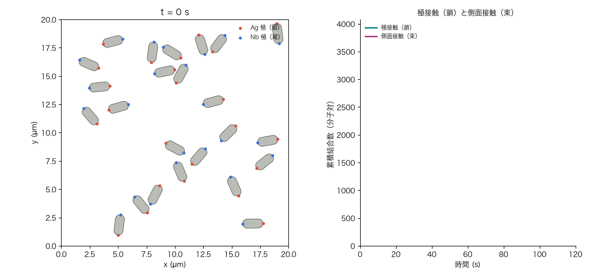
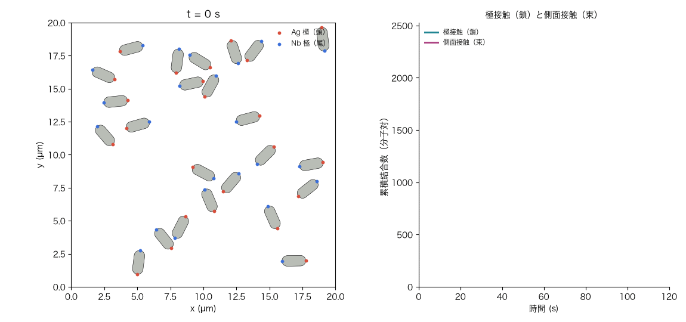
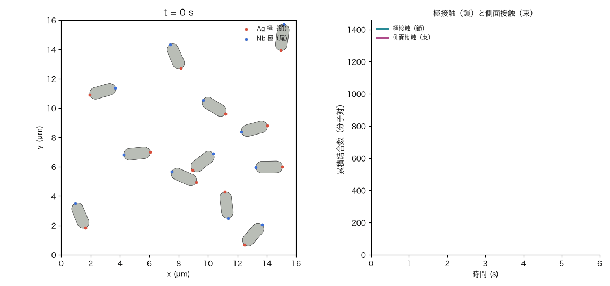
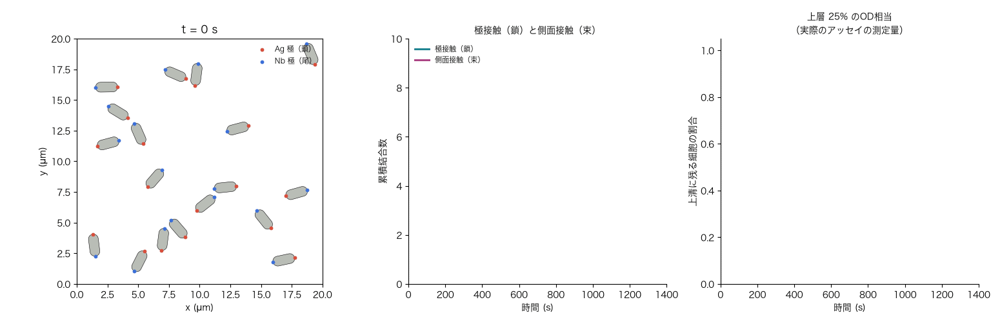
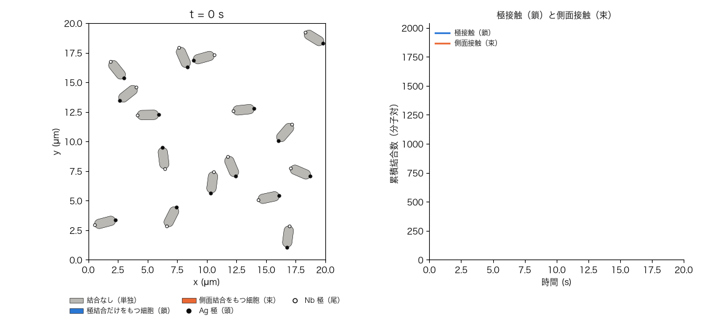
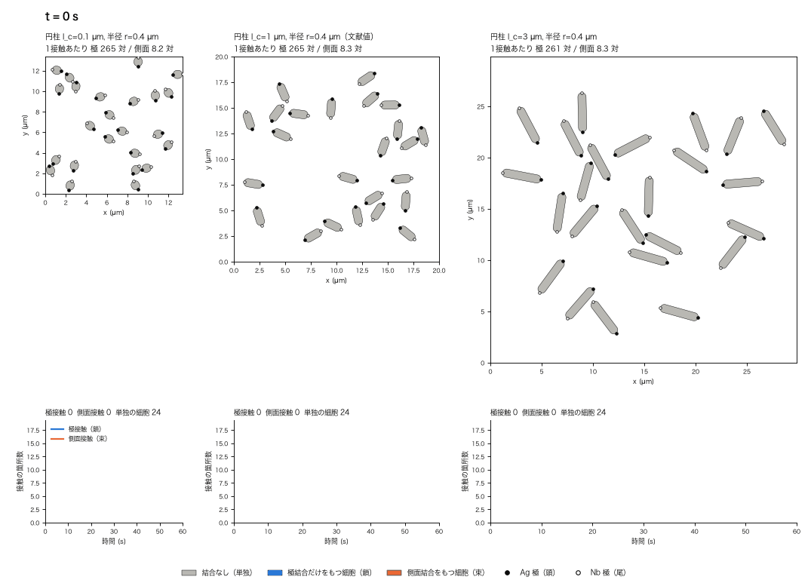
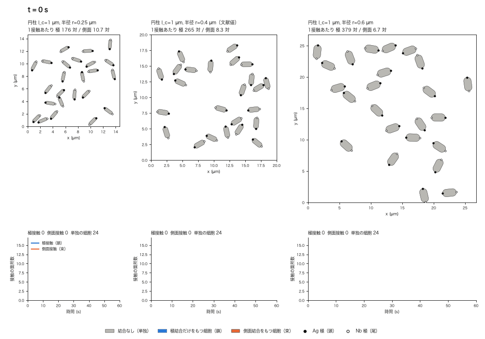
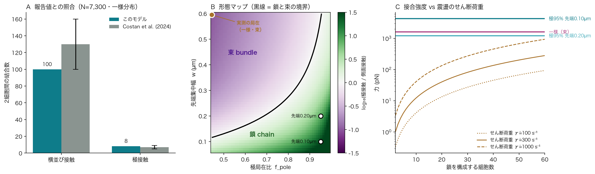
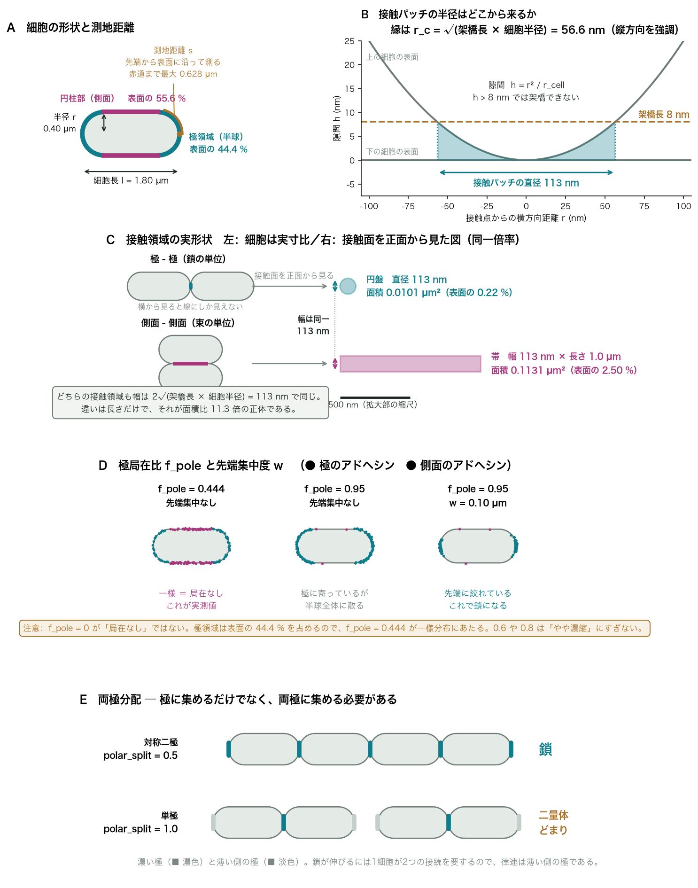

Claude codeを使ってモデリングして検証しています．全文目を通していますが，おかしなところがあれば大森まで，
termの使い方など所々不自然なところありますが，用語集なども作りましたのでぜひそちらを参照ください


# 細胞接着モデル

極局在させたアドヘシンで大腸菌どうしを接着させたとき、できあがる多細胞構造が
**一列に伸びる鎖になるのか、横に固まる束になるのか**を予測する粗視化モデル。

物理定数はすべて Costan et al., *Matter* (2024) の実測値に固定してあり、
調整パラメータを持たない。自由に動かせるのは**発現量**と**局在**の2つだけである。

## 時間発展シミュレーション（`adhesion.dynamics`）

下の「主要な結果」は、接触した2細胞がどちらの配置を取るかという**相対的な
有利不利**を予測する静的モデルの結論である。`adhesion.dynamics` はこの制約を
外し、多数の細胞が実際に出会い、不可逆に結合し、鎖・束へと育っていく過程を
時間発展させる。結合数の計算式は静的モデルと共有し、新たに扱うのは「いつ・
どちらが先に接触するか」という幾何と時間だけである。

| 局在（先端集中、鎖ができる条件） | 一様分布（実測値、対照） |
|---|---|
|  |  |

局在させると頭-尾の揃った有向な鎖が育つのに対し、一様分布では側面どうしが乱雑に
固まった束になる。これは「主要な結果」の表と同じ結論を、実際に多数の細胞が出会って
いく過程として示したものである。細胞は剛体クラスタにまとめず各細胞が独立に拡散し、
結合は有限の曲げ剛性を持つ柔軟なジョイントとして扱う。したがって鎖は棒のように
まっすぐではなく、実際の連鎖菌のように**しなり**、接触角度も平行に固定されず斜めの
接合も生じる。

**色の見方。** 細胞の塗りは、その細胞がもつ結合の種類を表す（**灰 = 結合なし、青 = 極結合
だけをもつ、オレンジ = 側面結合を1本でももつ**）。● は Ag 極、○ は Nb 極。かたまり全体
ではなく細胞ごとに塗るので、鎖の途中に側面接触が1本あっても、塗り替わるのはその2細胞
だけで、鎖がほとんど青のまま見える。極 = 青、側面 = オレンジの配色は、全ての図・動画で
共通（`scripts/figstyle.py`）。

```bash
python3 scripts/simulate_chain_formation.py --scenario chain    # f_pole=0.95, tip_width=0.10 µm
python3 scripts/simulate_chain_formation.py --scenario uniform  # 実測の一様分布（対照）
```

接着が自発的には不可逆であること（k_off ≈ 0）を踏まえると、時間発展させた
形態は熱力学的な有利不利ではなく、**「どちらの接触が先に成立するか」という
経路依存の結果**になる（`docs/literature_findings.md` 参照）。ただしこの
「不可逆」自体の生物学的な妥当性には限界があり、下の沈降モードの節で扱う。
母集団の密度・視野サイズ・総シミュレーション時間は較正できる経時データが
文献にないため、「動画として見やすい」という基準で選んだ自由パラメータで
ある。詳細な設計と置いた仮定（A15–A25）は `adhesion/dynamics.py` の
docstring と `docs/assumptions.md` を参照。

### 震盪モード（`--shear-rate-per-s`）は実際のアッセイの条件ではない



`shear_rate_per_s` を正の値にすると、後述の「震盪培養での挙動」の節と
同じせん断速度で平面クエット流（流れ方向 x を周期境界、勾配方向 y を壁とする）
を課す。細胞は決定論的な移流に加えて Jeffery (1922) の軌道式（A20、等価
アスペクト比の回転楕円体近似）で回転し、流れに対して向きを変えながら
タンブリングする。
せん断荷重が破断力を超えた極結合（鎖の背骨）は切れる（A22）が、既存の見積もり
（1結合あたりの荷重は破断力の1/56程度）どおり、典型的な震盪速度ではまず
発火しない（`tests/test_dynamics.py` で確認済み）。

**この機能を作った後、実際の凝集アッセイの手順を調べたところ、震盪は凝集の
形成過程には使われていないことが分かった。** Glass & Riedel-Kruse (2018)——
この合成接着系の原論文——の凝集アッセイは、育成培養こそ 300 rpm で振盪するが、
凝集そのものは「2菌株を短時間ボルテックスで混合 → 深底96穴プレートで**静置**
→ 24時間後に上層の光学密度を測定」という手順である（要旨レベルで確認）。
したがって震盪モードは実際に報告された条件ではなく、「もし凝集の間も振盪し
続けたら」という仮想的な比較対象として残してある。**実際のアッセイに対応する
のは次の沈降モードである。**

```bash
python3 scripts/simulate_chain_formation.py --scenario chain --shear-rate-per-s 200 \
    --total-time-s 6 --n-cells 12 --box-size-um 16 --frame-interval-s 0.0125
```

**動画は群を追う視点で描いている。** 震盪では細胞が毎秒数百 µm で流れ、固定した視点では
見づらい。そこで、総時間の最初の 1/5 の時点（この動画では 1.2 秒）で**最も長く結合している
群**（その時点で切れていない結合のうち最も古い結合を含むかたまり）を決め、その重心が常に画面の
中心に来る動く視点で描く。追跡している群（後から合流した細胞を含む）は通常の色、それ以外の細胞は
薄く描く。座標は群の中心からの相対位置で、壁（y = 0 と y = 箱の大きさ）は斜線の帯で示す。
`--focus largest` なら最初の 1/5 の時点で最大の群を追い、`--focus off` なら固定した視点
（周期境界をまたぐクラスタを影で示す）に戻る。

**計算コストに注意。** 震盪では接触の持続時間 `shear.contact_duration_s(γ̇) = 1/γ̇`
を取りこぼさないよう、時間刻み `dt` を自動的に縮める
（`adhesion.dynamics._safe_dt_for_shear`）。γ̇=200–300 /s では dt が静置条件の
数分の1になり、同じ `--total-time-s` でも計算時間が伸びる。まずは短い
`--total-time-s`（数秒）と少ない `--n-cells` で試すこと。

### 沈降モード（`--well-depth-um`）——実際の凝集アッセイに対応



実際の凝集アッセイ（震盪なし・静置 24 時間・上層の光学密度で判定）を再現する。
ボルテックスによる初期混合は、既存のランダムな初期配置がすでに表しているとみなし、
別途シミュレートしない。静置で凝集した後、**大きい凝集塊ほど Stokes 則で速く
沈み**（等価球半径は A16 と同じ n^(1/3) スケーリング）、鉛直方向に離れすぎた
細胞どうしは結合できなくなる。動画右側の「上清に残る細胞の割合」が実際に
測定される OD600 相当の量であり、大きい塊が沈むにつれて下がっていく
（動画では沈んだ細胞ほど淡く描かれる）。

```bash
python3 scripts/simulate_chain_formation.py --scenario chain --well-depth-um 600 \
    --total-time-s 1400 --n-cells 18 --box-size-um 20 --frame-interval-s 5.8
```

E. coli の浮遊密度は培地の浸透圧に依存して 1.08–1.16 g/cm³ の範囲で報告されて
いるが、個々の論文の全文は照合していないため、密度差は A18・A19 と同じ性格の
実効パラメータとして扱う（A23）。深底96穴プレートの物理的な深さはおよそ
30000–44000 µm だが、実際の充填量（液柱の高さ）は原著に明記されていないため、
これも自由パラメータである。上の動画は液柱を 600 µm（実際の1/50〜1/70程度）に
縮め、模擬約23分（1400秒）で沈降が進む様子を見せている。「大きい塊ほど速く
沈む」という定性的な傾向（沈降速度が塊のサイズの2/3乗で増える）は、この
縮尺の選び方によらず成り立つ。

> **液柱の深さを変えた経緯。** 以前の動画は液柱 1500 µm で、seed 0 の実行は早い段階で
> 11 細胞の大きな鎖ができ、約 1100 秒でそれが沈んだ。時間刻みを収束した値（0.0025 s）に
> 変えると、同じ seed でも最大 6 細胞ほどのかたまりまでしかできず、1500 µm では
> 1400 秒の間に上層から出る細胞がなかった（6 細胞の沈降距離 326 µm < 上層 25% の
> 375 µm）。そこで、シードは seed 0 のまま、液柱を 600 µm に縮めた。このとき 3 細胞以上の
> かたまりは 1000 秒以内に上層から出る。どのくらいの大きさのかたまりまで育つかは
> シードで大きく変わるので、この動画は沈降の仕組みの説明であって、凝集の速さの
> 予測ではない。

**「不可逆」の生物学的な妥当性には限界がある（`--k-off-per-s`）。** Costan et al.
(2024) の Supplemental Note 4 原文を確認したところ、「k_off はゼロとみなすのが
最良の推定」という結論は、荷重速度 5–100 pN/s という狭い範囲で破断力対数荷重
速度プロットの傾きを検出できなかったことに基づく**検出限界**の主張であり、
k_off が数学的に厳密なゼロだと証明したものではない。しかもこの結合
（anti-EPEA / EPEA）は、Costan et al. が他の測定（分子数・拡散・局在）に使って
いる例外的に安定な anti-GFP / GFP ペア（市販品「GFP-Trap」、Kd ~ 1 pM）とは
異なる、より低親和性（ナノモル）のペアである。他のナノボディ-抗原ペアの独立
した SPR 測定では k_off ~ 10⁻³–10⁻² /s（半減期にして数十秒〜数分）が珍しく
ない。短時間のデモ（鎖形成・震盪）ではこの不確かさは結論を左右しないが、
**24時間の沈降モードでは無視できない**——もし真の k_off がこの「ふつうの」
範囲にあれば、24時間で半減期を100回以上経ることになり、束から鎖への組み替えが
起こりうる可逆に近い過程になる（詳細は A24）。`--k-off-per-s` に非零の値
（目安 1e-4〜1e-2 /s）を渡すと、この可逆性を試せる。

### 運動性モード（`--swim-speed-um-s`）——任意の探索ツール（既定は無効）



ここまでの動画はすべて、細胞が受動的なブラウン拡散だけで出会うと仮定していた。
使用株 MG1655 は運動性を持つ（半固形寒天での運動性アッセイで確認されている
一般的事実）ため、大腸菌自身の遊泳を考慮したくなる。`--swim-speed-um-s` を
正の値にすると、結合していない自由な細胞は **run-and-tumble 運動**（直進遊泳と
方向転換を交互に繰り返す、大腸菌の走化性研究で古典的な運動様式）をするように
なる（A25）。結合してクラスタの一部になった細胞は能動推進を止める。run・tumble
の継続時間はそれぞれ指数分布（ポアソン過程）に従うとし、速度・平均継続時間・
方向転換角度の既定値は **Berg & Brown (1972)**——大腸菌の走化性を3次元追跡で
解析した古典的な研究——の野生株 AW405 のデータを全文照合した値である
（速度 14.2±3.4 µm/s、run 0.86±1.18 s、tumble 0.14±0.19 s、方向転換角度
68.0±36.0°）。方向転換角度は実際には0°に偏らない非一様な分布（原著 Fig. 3）
なので、平均・標準偏差が一致するガンマ分布からサンプルする。

```bash
python3 scripts/simulate_chain_formation.py --scenario chain --swim-speed-um-s 14.2 \
    --total-time-s 20 --n-cells 16 --box-size-um 20 --frame-interval-s 0.14
```

**この機能は既定で無効にしてあり、それには理由がある。** 当初は「実際の凝集は
速く進むので受動拡散だけでは説明しにくい」という動機で追加したが、生物学的な
妥当性を検証したところこの動機は成り立たなかった。

- **拡散だけで十分説明がつく。** スモルコフスキーの会合速度で見積もると、
  実際のアッセイの典型的な菌体濃度（OD600 0.1–1、~10⁸–10⁹ 細胞/mL）では
  受動拡散だけで凝集の半減時間は **~4–40 分**である（等価球半径 0.57 µm、
  並進拡散係数 0.38 µm²/s から計算）。1時間以内の凝集は能動運動を持ち出す
  までもなく拡散で説明できる。そもそも根拠にしていた「1時間以内」という速さ
  自体、全文照合できた文献には見当たらないうろ覚えの主張だった。
- **アッセイ条件で運動性が保たれるか疑わしい。** 文献値は指数増殖期の活発に
  泳ぐ AW405 の測定だが、実際のアッセイは定常期まで培養した細胞を深底プレートで
  静置（酸素律速になりうる）し、しかも合成アドヘシンを大量発現（外膜への負荷）
  している。運動性は静止期・低酸素・代謝負荷で落ちるのが一般的である。
- **遊泳は沈降に抗する。** アッセイの読み出しは沈降（上清の光学密度）であり、
  泳ぐ細胞はむしろ沈みにくくなる——能動運動は測定される凝集を速めるとは限らず、
  遅らせる可能性すらある。

したがって運動性モードは「もし細胞が活発に泳いだら会合はどれだけ速まりうるか」
を探る**任意の探索ツール**であって、実際のアッセイの既定条件ではない。上に
挙げた株・条件の違い（AW405 対 MG1655、追跡用培地対アッセイ条件、3次元で
測った旋回角度を2次元に転用）も踏まえ、定量的な予測としては使えない（詳細は
A25）。

### 細胞の形を変えたとき（円柱の長さ・半球の曲率）

細胞の形も時間発展のパラメータにした（`DynamicsConfig(shape=CellShape.from_cylinder(円柱長, 半径))`）。
半球の半径は円柱の半径と等しく、曲率 1/r は太さと切り離せないので、全長ではなく円柱長
l_c を固定して半径 r を動かし、2つを独立な軸にしている。**形を指定しなければ、形を
パラメータにする前と同じ計算になる**（旧既定の `dt = 0.02 s` を指定すれば、6つの運転モードで
ビット単位で一致することを確認した）。

**円柱長 l_c = 0.1 / 1.0（文献値）/ 3.0 µm**（局在。一様分布の対照は `shape_cylinder_uniform.gif`）



**半径 r = 0.25 / 0.40（文献値）/ 0.60 µm、曲率 4.0 / 2.5 / 1.7 /µm**（局在。対照は `shape_radius_uniform.gif`）



動画は形ごとに「平均に最も近い1回の実行」で、統計ではない。画面の見方は
[`docs/shape_movies.md`](docs/shape_movies.md)。統計（各条件20回）の結論:

- **円柱が長いほど、局在させても極結合（鎖）の割合が下がり、束が増える。** 最初の10本の
  うち極結合の割合は l_c = 0.1 → 1.0 → 3.0 µm で 0.82 → 0.68 → 0.51。結合数を既定形状に
  固定しても同じ曲線になるので、結合数ではなく細胞の出会い方（衝突の幾何）による。
  箱の取り方・回転拡散の見積もりを変えても向きは変わらない。
- **半球の曲率（半径）の効果は、細い側では極結合が減る向きで一貫するが、太い側は置き方で
  変わる。** 半径 0.25 µm では極結合の割合が 0.50（文献値の半径で 0.68）に下がり、その大部分は
  結合数の低下による（結合数を固定すると 0.63）。半径 0.8 µm では、全て反映で 0.68（文献値と同じ）、
  結合数を固定すると 0.53、置き方で 0.52–0.68 に散る。半径を太くして鎖が増える根拠はない。
  凝集の速さの形依存性は、箱の取り方で逆転する。
- 一様分布は形によらず束になる。

詳細・表・限界・手法上の注意（時間刻みの収束、混み具合の対照）は
[`docs/shape_scan.md`](docs/shape_scan.md)、図は `results/figures/shape_scan_*.png`。

```bash
python3 scripts/run_shape_scan.py dynamic --seeds 20 --jobs 8   # 形の掃引（数時間、再開可能）
python3 scripts/plot_shape_scan.py                               # 図と集計表
python3 scripts/simulate_shape_comparison.py --scan cylinder     # 動画（--scan radius で曲率）
python3 scripts/export_shape_docs.py                             # docs/shape_scan.md と docs/shape_movies.md
```

**時間刻みについて。** 旧既定の `dt = 0.02 s` は側面結合を過大に数えていた（文献値の形で約 15%）。
収束した `dt = 0.0025 s` を既定にし、この README の動画と数値は全て作り直した
（沈降の動画は、液柱を 600 µm に変えた経緯を沈降の節に記した）。結合の構成比は収束しているが、
半径 0.25 µm のような細い形では、単量体の数（凝集の速さ）にまだ残差がありうる
（`docs/shape_scan.md` の「時間刻みの収束」）。δ が大きすぎる形には `DynamicsConfig` が警告する。

## 主要な結果

**実測されている局在（一様分布）は、鎖ではなく束を予測する。**

| 局在（N = 7,300） | 横並び | 濃い極 | 薄い極 | 接合強度 | 構造 |
|---|---:|---:|---:|---:|---|
| 一様（実測値） | 100 | 8 | 8 | 1,607 pN | **束** |
| 極 80 % 対称二極 | 48 | 15 | 15 | 765 pN | 束 |
| 極 95 % 対称二極 | 25 | 18 | 18 | 409 pN | 束 |
| 極 95 % 二極 + 先端 0.20 µm | 9 | 75 | 75 | 1,209 pN | **鎖** |
| 極 95 % 二極 + 先端 0.10 µm | 8 | 265 | 265 | 4,262 pN | **鎖** |
| 極 95 % **単極** + 先端 0.10 µm | 8 | 529 | 0 | 8,525 pN | **二量体どまり** |

要点は3つある。

**1. 極に集めるだけでは足りず、極の先端に絞る必要がある。**
極への局在比を 0.95 まで上げても、半球全体に広がったままでは束のままである。
接触パッチの半径は 56.6 nm しかなく、極半球（測地距離で 0.63 µm）の大部分は
接触に寄与しない。効くのは先端集中度 *w* で、パッチ内の分子数は *w*⁻² で増える。

| 先端集中度 *w* | 鎖になるのに必要な極局在比 |
|---|---:|
| 集中なし（極半球に一様） | 事実上達成不能 |
| 0.30 µm | > 0.819 |
| 0.25 µm | > 0.762 |
| 0.20 µm | > 0.679 |
| 0.15 µm | > 0.554 |
| 0.10 µm | > 0.444（わずかな偏りで足りる） |

**2. 発現量では形は変わらない。**
極接触も側面接触も分子数に比例するため、比を取ると分子数が消える。
すなわち**発現量は接合の強さを決め、局在は形を決める。両者は干渉しない。**
プロモーターを強くしても束が鎖になることはない。

**3. 両極に集める必要がある。**
鎖が伸びるには1細胞が2つの接続を持たねばならず、その律速は分子が少ない側の極である。
単極局在では接合1つあたりは2倍強くなる代わりに、相手を1つしか持てず二量体で止まる。
外膜タンパクに自然に生じる偏りは古い極への片側性の蓄積（Rassam et al. 2015）であり、
まさにこの単極型にあたる。**放置して出てくる局在は鎖には使えない。**



## 用語の図解

本文と図に出てくる用語のうち、初見で分かりにくく、かつ結論を左右するものを図にまとめた。
用語の一覧は [docs/glossary.md](docs/glossary.md) にある。



とくに **A**（測地距離）、**B**（接触パッチの半径がどこから来るか）、
**D**（*f*pole = 0.444 が一様分布であること）は誤解しやすい。

## 検証

モデルには調整パラメータがない。したがって以下の一致は較正の結果ではなく予測である。

| 量 | このモデル | Costan et al. (2024) | 一致 |
|---|---:|---:|---|
| 横並び接触の結合数 | 100 対 | 130 ± 30 対 | 1 SD 以内 |
| 極接触の結合数 | 8 対 | 7 ± 2 対 | 1 SD 以内 |
| 接触面積割合 *A*con | 0.0023 – 0.0274 | 0.002 – 0.036 | レンジ一致 |

さらに原著の Supplemental Note には *A*con の導出が式の形で載っているため、
出力だけでなく**式そのものを突き合わせられる**。端 - 端接触について、

| | 式 | 値 |
|---|---|---:|
| 原著 (S32) | *A*ee = 2π*rM* | 0.01005 µm² |
| 本モデル | patch = π(2*M*)*r* | 0.01005 µm² |

この2つは**恒等的に同じ式**である。本モデルは原著の式を参照せず細胞形状から
独立に導出しているので、**同じ量が二つの独立な経路から得られた**ことになる。

原著が 2D 投影の近似と自ら断っている配置（直交・斜め）では、本モデルは曲面上で
直接数え上げるぶん小さい値を返す。詳細は
**[docs/source_comparison.md](docs/source_comparison.md)** にまとめた。
この差は結論には影響しない（極接触と側面接触の比は本モデルで 11.3、原著の値では 16 で、
どちらでも「局在させなければ束になる」は変わらない）。

検証は `tests/test_validation.py` にテストとして固定してあり、将来モデルを変更して
文献との整合が崩れた場合はテストが失敗する。

## 使った文献値と置いた仮定

科学的な再現性のため、この2つは明示的に分離して管理している。

- **[docs/literature_findings.md](docs/literature_findings.md)** — 一次文献8本の全文照合で分かったこと。
  **設計に直接効く発見を含む。まずここを読むとよい。**
- **[docs/project_design.md](docs/project_design.md)** — 本モデルが対象にしている設計（「One Direction」）と、
  接着機構（ペリプラズムでの CoilR–CoilE 係留）の説明。**最初にここを読むとよい。**
- **[docs/model_scope_audit.md](docs/model_scope_audit.md)** — モデルが設計資料に沿っているかの監査。
  一致している点と、ずれている点を列挙している。
- **[docs/localization_feasibility.md](docs/localization_feasibility.md)** — 極局在は実現できるかの文献調査。
- **[docs/glossary.md](docs/glossary.md)** — 用語集。先端集中度・接触パッチ・極局在比など、
  本文と図に出てくる用語の定義、記号、コード上の名前、代表値の対応表。**最初にここを読むとよい。**
- **[docs/source_comparison.md](docs/source_comparison.md)** — 原著の導出式との照合。
  どこが一致し、どこがなぜ違うかを式のレベルで記録している。
- **[docs/parameters.md](docs/parameters.md)** — 使用した文献値の一覧。
  値・単位・不確かさ・出典が対応表になっている。
- **[docs/assumptions.md](docs/assumptions.md)** — モデルが置いている 25 個の仮定（静的モデル14 + 時間発展シミュレーション11）。
  各仮定について、そう置いた根拠と、**もし破れていたら結果がどう変わるか**を併記。

どちらも `adhesion/literature.py` と `adhesion/assumptions.py` から自動生成される
（`python3 scripts/export_docs.py`）。**コード中に出典のない数値を直書きしている
箇所はなく**、ドキュメントと実装が食い違うことはない。

```python
# adhesion/literature.py — 数値は必ず出典と一体で定義する
RUPTURE_FORCE = LiteratureValue(
    symbol="F_b",
    value=16.1,
    uncertainty=0.4,
    unit="pN",
    quantity="単一アドヘシン結合の破断力",
    source="costan2024",
    note="光ピンセットによる測定（n = 14 細胞）。要約表では 16.2、系統誤差 1.8 pN。",
)
```

仮定も同様に第一級のオブジェクトとして扱い、各モジュールが自分の依存する仮定を
宣言する。存在しない ID を参照すると読み込み時に失敗するため、仮定を変更すれば
参照側も必ず追随する。

```python
# adhesion/model.py
MODEL_ASSUMPTIONS = uses("A1", "A2", "A3", "A4", "A5", "A6", "A7", "A10")
```

## パラメータ

| 分類 | パラメータ | 備考 |
|---|---|---|
| **自由 ①** | 発現量 *N*（0 – 15,300 分子/細胞） | aTc 誘導で実験的に制御。原著が誘導濃度との対応を実測 |
| **自由 ②** | 局在（`f_pole`, `tip_width_um`, `polar_split`） | 設計で変えたい量。実測の出発点は一様分布 |
| 固定 | 細胞寸法、架橋長、破断力、拡散係数ほか | すべて実測値（[docs/parameters.md](docs/parameters.md)） |
| 従属 | 結合数、接触面積、表面密度、接合強度 | 上記から計算される |

**結合の数は自由パラメータではない。** 幾何と発現量から決まる従属量であり、
1結合あたりの破断力は実測値に固定されるため、接着の強さの軸には自由パラメータが
1つも残らない。接合強度は単純な積になる。

```
接合強度 = 結合数 × 16.1 pN
```

なお破断力 16.1 pN は **anti-EPEA / EPEA** ペアの測定値である。原著は3つの
Nb-Ag ペアを使い分けており、分子数・拡散・分布は anti-GFP / GFP、破断力は
anti-EPEA / EPEA で測っている。原著自身が「パラメータはペアごとに、とくに
*F*b は変わる」と註記しているとおり、**破断力はペアの選択で変えられる設計変数**
である。参考までに anti-GFP / GFP では AFM で 28–45 pN が報告されている
（Klamecka et al. 2015）。

## 震盪培養での挙動

散逸率 ε = 0.01 – 1 W/kg のとき、せん断速度は γ̇ = √(ε/ν) = 100 – 1000 s⁻¹。
このときコルモゴロフ長は 32 – 100 µm で細胞（1.8 µm）よりはるかに大きく、
細胞は乱流ではなく局所的な層流せん断の中にいる。

震盪の主な役割は**接合を壊すことではなく、細胞を出会わせること**である。
せん断による衝突頻度はブラウン運動の 27 – 267 倍に達する一方、
γ̇ = 300 s⁻¹ で 10 細胞の鎖にかかる張力は 12.3 pN にすぎず、
これを結合数で割ると単結合の破断力 16.1 pN には遠く届かない。

したがって律速は力学ではなく、**衝突したときに極どうしが向き合う確率**である。

## 構成

```
adhesion/
  literature.py    文献値。値・単位・不確かさ・出典を一体で保持
  assumptions.py   モデルが置く仮定。根拠と、破れた場合の影響つき
  geometry.py      接触幾何。表面の求積と、架橋しうる分子の数え上げ
  shape.py         細胞の形（円柱の長さ・半球の曲率半径）。静的モデルと時間発展が共有
  model.py         発現量と局在から接着と形態を予測（時間を持たない）
  dynamics.py      多数の細胞が時間とともに出会い、鎖・束へ育つ過程の時間発展
  shear.py         震盪培養での衝突頻度とせん断荷重
  kinetics.py      荷重下での結合寿命（別ペアの値による桁の見積もり）
scripts/
  validate.py      文献値との照合表を出力
  run_scan.py      局在の掃引 → CSV
  make_figures.py  主要結果の図
  make_glossary_figure.py  用語の図解
  simulate_chain_formation.py  鎖・束が時間とともにできる様子の動画
  run_shape_scan.py            細胞の形（円柱長×半径）の掃引 → CSV
  plot_shape_scan.py           形の掃引の図と集計表
  simulate_shape_comparison.py 形ごとの鎖・束の形成を並べた動画
  export_docs.py   docs/ をコードから生成
tests/             210 件。うち検証テストが文献との整合を式レベルで固定する
docs/              自動生成されるパラメータ表と仮定一覧
references/        BibTeX
results/           図とデータ（動画は results/animations/）
```

## 実行方法

```bash
pip install -r requirements.txt

python3 -m unittest discover -s tests -t .   # 210 件
python3 scripts/validate.py                   # 文献値との照合
python3 scripts/run_scan.py                   # 掃引 → results/data/
python3 scripts/make_figures.py               # 図 → results/figures/
python3 scripts/make_glossary_figure.py       # 用語の図解 → docs/figures/
python3 scripts/simulate_chain_formation.py --scenario chain    # 鎖ができる動画
python3 scripts/simulate_chain_formation.py --scenario uniform  # 束ができる動画（対照）
python3 scripts/export_docs.py                # docs/ を再生成
```

単発の予測は次のように書ける。

```python
from adhesion.model import predict, UNIFORM_F_POLE

predict(7300, UNIFORM_F_POLE).morphology                  # 束（実測の局在）
predict(7300, 0.95, tip_width_um=0.10).morphology         # 鎖
predict(7300, 0.95, 1.0, tip_width_um=0.10).morphology    # 二量体どまり
```

## モデルの適用範囲（静的モデル `adhesion.model`）

このモデルは**接触した2細胞がどの配置を取るかという相対的な有利不利**を予測する。
以下は扱っていない（仮定 A7）。時間発展そのものは上記の `adhesion.dynamics` が扱う。

- 衝突するまでの待ち時間、凝集にかかる時間、鎖長分布の時間発展
- 接触後の細胞の回転による再配置
- 接触中の拡散によるアドヘシンの集積（仮定 A12）

本系のアドヘシンペアについて解離速度定数も2次元親和性も測られていないため、
速度論を入れても値を埋められない。

ただし別のペア（anti-GFP / GFP）については解離速度定数
*k*off = 1.45×10⁻⁴ s⁻¹ と障壁位置 Δ*x* = 1.59 nm が測られており、
`adhesion.kinetics` で桁の目安を出せる。それによれば

- 無荷重での結合寿命は **約 1.9 時間**
- 荷重が効き始めるスケールは *kT*/Δ*x* ≈ **2.6 pN**
- γ̇ = 300 s⁻¹ で 10 細胞の鎖にかかる 1 結合あたりの荷重は 0.046 pN であり、
  寿命はほとんど変わらない（無荷重の 98 %）

**時間を入れても力学が律速にならないという結論は変わらない見込みである。**

## 設計との対応と、残された問い

本モデルが対象にしているのは「One Direction」（iGEM Keio-Japan 2026）の設計である。
詳細は [docs/project_design.md](docs/project_design.md)。要点だけ記すと、

- 外膜の Intimin は、**ペリプラズムでの CoilR–CoilE 結合**によって内膜側の
  極マーカー（PopZ）へ係留される。PopZ も DivIVA も細胞質・内膜側の因子で
  そのままでは外膜タンパクに届かないが、この係留がその隔たりを橋渡しする
- 2つの極に **Ag と Nb を分けて**提示するので、Ag 極は Nb 極としか結合できない。
  したがって鎖は**頭-尾に揃い、向きを持つ**
- 本モデルはこれを `distinct_adhesins_per_pole=True`（既定）として扱い、
  形態を `DIRECTED_CHAIN`（鎖・向きあり）として出力する

なお **Ag/Nb を極ごとに分けても結合数は変わらない**。等量発現なら接合あたりの
結合数は `min(n_Ag, n_Nb) = N·f_pole/2` で、同種を両極に置いた場合と一致する。
変わるのはどの極とどの極が結合できるかであり、そこから向きが生まれる。

### 本モデルが答えたこと

- 一様分布では束になる（極-極 8 対に対し側面 100 対）
- 向きのある鎖には**両極**が必要（片極だけでは二量体で止まる）
- 極に集めるだけでは足りず、**先端に絞る**必要がある
- 発現量では形は変わらない。発現量は強さを、局在は形を決める
- 震盪培養のせん断は接合を壊さない

### 残された問い

**モデルの外にあるもの**

- 係留機構が実際にどれだけ先端に絞れるか（= `tip_width_um` の実測値）
- PopZ 極と DivIVA 極に、それぞれ何分子の Intimin を係留できるか
- 外膜タンパクの島構造（直径 0.5 µm）が係留にどう影響するか（仮定 A11）。
  ただし係留は拡散捕捉ではなく直接の繋ぎ止めなので、島の制約を回避できる可能性がある

**モデル自体に足りていないもの**（[docs/model_scope_audit.md](docs/model_scope_audit.md)）

- ~~**ブラウン運動**。資料は「多価結合とブラウン運動を考慮したシミュレーション」を
  指定しているが、本モデルは仮定A7で時間を持たない。~~
  → **`adhesion.dynamics` で対応済み**（冒頭の「時間発展シミュレーション」の節を参照）。
  方向性接着の様子を可視化する動画も作れるようになった
- **架橋長**。2*M* = 8 nm は Costan et al. の構築の値であり、この設計の Intimin は
  LysM を CoilE に置換し Spacer を持つ。到達距離は変わるはずである
- **誘導系**。本モデルは aTc 濃度に紐づいているが、資料が使うのは IPTG と
  プロモーター強度である

## 文献の扱い方

**値は全文を確認した文献からのみ取る。**検索結果の要約や、他の論文が引用している
孫引きの数値をモデルに入れてはならない。この規則は
`tests/test_literature.py::test_values_only_come_from_fully_verified_sources`
で強制してあり、未確認の文献から値を取るとテストが失敗する。

| 文献 | 全文確認 | 供給している値 |
|---|---|---:|
| Costan et al. (2024) ＋ Supplement | ✅ | 18 |
| Berg & Brown (1972) | ✅ | 4 |
| Rassam et al. (2015) | ✅ | 2 |
| Klamecka et al. (2015) | ✅ | 2 |
| Glass & Riedel-Kruse (2018) | ✅ | 0（機構の確認に使用） |
| Lim & Bernhardt (2019) | ✅ | 0（同上） |
| Lin et al. (2021) | ✅ | 0（同上） |
| Chou et al. (2025) | ✅ | 0（同上） |

Klamecka については照合の結果、**当初 3 値を取っていたうち 2 値が誤りだった**。
解離速度定数 *k*off と解離定数 *K*D は Klamecka 自身の測定ではなく、
Kirchhofer et al. (2010) および Kubala et al. (2010) からの引用値を
Bell–Evans 回帰に固定して使っているだけだった。両論文とも未入手のため、
この 2 値はモデルから削除した（`adhesion/kinetics.py` では呼び出し側が
明示的に渡す形にしてある）。

### 出典を確認できていない見積もり

- **外膜タンパクの総面密度（10⁵ /µm² のオーダー）** — 極先端への濃縮が物理的に
  可能かを論じる比較対象に使っているが、一次文献を確認していない。
  仮定 A11 の議論の強さはこの値に依存する。`literature.UNVERIFIED_ESTIMATES` に
  明示してある

### 全文未確認のまま書いた文書

- **[docs/localization_feasibility.md](docs/localization_feasibility.md)** —
  検索結果の要約のみに基づく。**モデルには取り込んでいない。**
  IcsA の極局在、アミダーゼ欠損による鎖形成、intimin の一様分布などは
  すべてこの状態にある

## 読むべき文献

現時点で入手・全文確認が必要なもの。優先度順。

| 優先 | 文献 | 何のために |
|---|---|---|
| 高 | **Lim & Bernhardt (2019) Mol. Microbiol.**（POLAR 系） | 本設計の中核であるペリプラズム CoilR–CoilE 係留の原典。係留がどれだけ極に絞れるか（`tip_width_um`）の唯一の手掛かり |
| 高 | **Lin et al. (2021) Nat. Commun.**（PopZ） | 発現量で単極/両極が切り替わる条件。実験①の設計根拠であり、`polar_split` の実測値に相当する |
| 高 | **Glass & Riedel-Kruse (2018) Cell** | アドヘシン・ツールボックスの原典。鎖ができた前例があるか、intimin 構築の詳細（架橋長 8 nm の内訳） |
| 中 | **Rassam の島構造を裏づける外膜密度の一次文献** | 上記 UNVERIFIED_ESTIMATES を解消するため |
| 中 | **Kirchhofer et al. (2010) Nat. Struct. Mol. Biol.** | 削除した *k*off と *K*D の原典。結合寿命の議論を復活させたい場合に必要 |
| 低 | **Leo et al. (2016) JBC** / **Oberhettinger et al. (2012) PLoS ONE** | LysM 除去と CoilE 付与の妥当性（実験⑤の根拠） |
| 低 | Salema et al. (2013)、Spector et al. (2010) | Costan が期待値の比較に使っている文献。モデルは変わらない |

## 引用文献

- Costan, S. A., Ryan, P. M., Kim, H., Wolgemuth, C. W. & Riedel-Kruse, I. H. (2024). Biophysical characterization of synthetic
  adhesins for predicting and tuning engineered living material properties.
  *Matter* **7**, 2125–2143. <https://doi.org/10.1016/j.matt.2024.03.019>
- Berg, H. C. & Brown, D. A. (1972). Chemotaxis in Escherichia coli analysed by
  Three-dimensional Tracking. *Nature* **239**, 500–504.
  <https://doi.org/10.1038/239500a0>
- Glass, D. S. & Riedel-Kruse, I. H. (2018). A Synthetic Bacterial Cell-Cell Adhesion
  Toolbox for Programming Multicellular Morphologies and Patterns.
  *Cell* **174**, 649–658. <https://doi.org/10.1016/j.cell.2018.06.041>
- Klamecka, K., Severin, P. M., Milles, L. F., Gaub, H. E. & Leonhardt, H. (2015).
  Energy profile of nanobody-GFP complex under force.
  *Phys. Biol.* **12**, 056009. <https://doi.org/10.1088/1478-3975/12/5/056009>
- Rassam, P., Copeland, N. A. et al. (2015). Supramolecular assemblies underpin
  turnover of outer membrane proteins in bacteria.
  *Nature* **523**, 333–336. <https://doi.org/10.1038/nature14461>
- Tirado, M. M. & García de la Torre, J. (1979). Translational friction coefficients
  of rigid, symmetric top macromolecules. Application to circular cylinders.
  *J. Chem. Phys.* **71**, 2581–2587. <https://doi.org/10.1063/1.438613>

BibTeX は [references/references.bib](references/references.bib) にある。

## ライセンス

MIT License（[LICENSE](LICENSE)）
