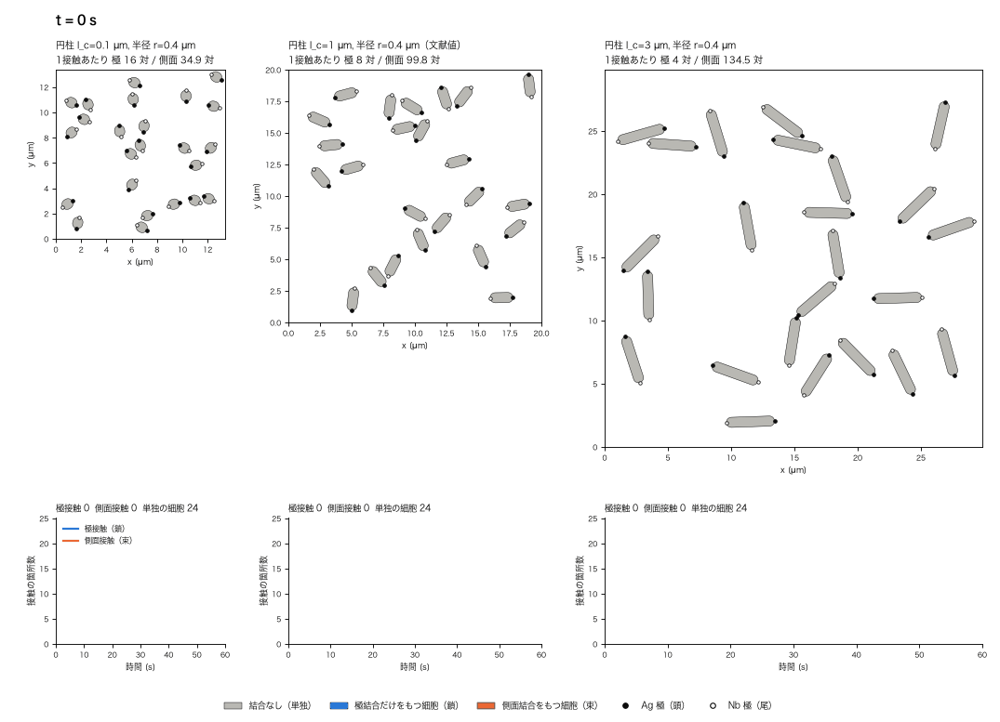
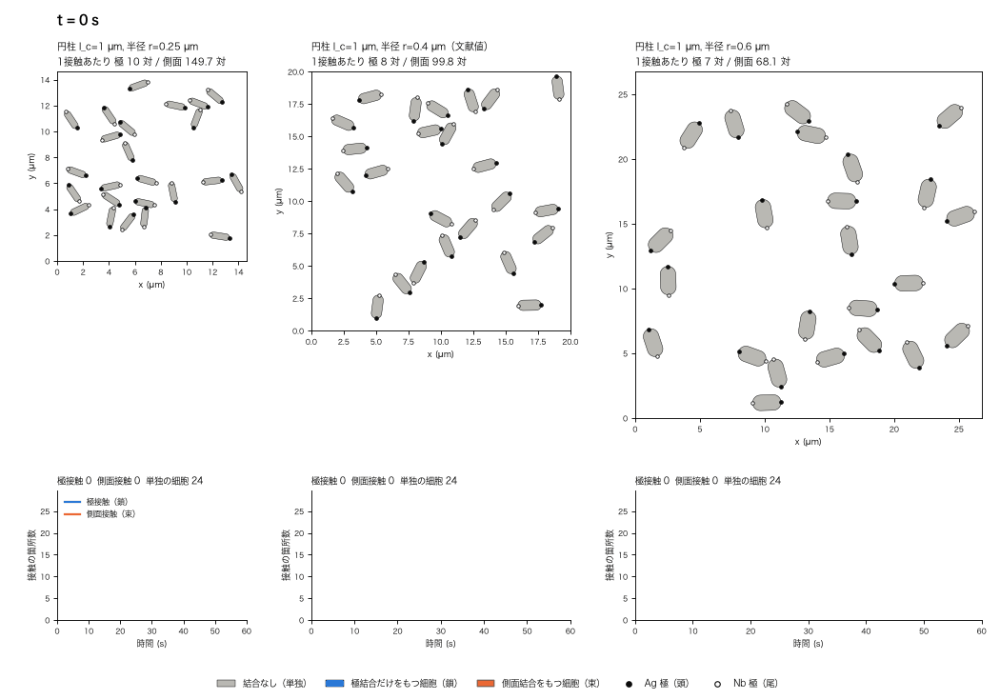

# 細胞の形を変えたときの時間発展動画

大腸菌の形（円柱の長さ、半球の曲率）を変えたとき、鎖や束ができる過程がどう変わるかを、
形の違う細胞集団を横に並べて同時に時間発展させた動画 4 本の見方と作り方。

このページは**動画だけ**を説明する。形ごとの統計と結論の確かさは
[`shape_scan.md`](shape_scan.md) にある。

> **動画は1回の実行で、統計ではない。** 同じ条件でもシードで結果はかなり変わる。
> 動画から言えるのは「こういう形のかたまりができうる」という絵であって、
> 「形を変えるとこうなる」という頻度や傾向ではない（[動画から言えること・言えないこと](#動画から言えること言えないこと)）。
>
> このページの表は `scripts/export_shape_docs.py` が、動画と同時に出力される JSON から生成する。

## 動画の一覧

| 動画 | 比べる形 | アドヘシンの分布 |
|---|---|---|
| [1. 円柱長・局在](#1-円柱長を変える局在) | 円柱長 l_c = 0.1 / 1.0（文献値）/ 3.0 µm、半径 0.40 µm 固定 | 局在（f_pole = 0.95、先端幅 0.10 µm） |
| [2. 円柱長・一様](#2-円柱長を変える一様分布) | 同上 | 一様（実測の分布、対照） |
| [3. 曲率・局在](#3-半球の曲率半径を変える局在) | 半径 r = 0.25 / 0.40（文献値）/ 0.60 µm、円柱長 1.0 µm 固定 | 局在 |
| [4. 曲率・一様](#4-半球の曲率半径を変える一様分布) | 同上 | 一様 |

どの動画も、**24 細胞を 0〜60 秒**時間発展させ、3 つの形を並べている。局在と一様は
同じ形・同じ条件で、アドヘシンの分布だけが違う。

## 画面の見方


**上段: 細胞が動く箱（2 次元）**

- 細胞はカプセル形（円柱の両端に半球）。**拡大率は 3 つのパネルで同じ**なので、細胞の大きさの違いが
  そのまま見える。箱の大きさはパネルごとに違う（下の「比べている形」）。
- **細胞の色は、その細胞がもつ結合の種類**を表す。**灰色**は結合なし（単独）、**青**は極結合だけを
  もつ細胞（鎖・二量体）、**オレンジ**は側面結合を1本でももつ細胞（束）。かたまり全体ではなく
  細胞ごとに塗るので、鎖の途中に側面接触が1本あっても、塗り替わるのはその2細胞だけ。
  この色（極 = 青、側面 = オレンジ）は、全ての図・動画で共通。（統計で使う「束」は、側面結合を
  1本でも含む*かたまり*という別の定義。）
- **● が Ag 極（頭）、○ が Nb 極（尾）**。極どうしで結合できるのは Ag 極と Nb 極だけなので、
  極接触でできる鎖は必ず頭-尾に揃う（● と ○ が向き合って接する）。
- 結合線は細胞の下に描かれ、架橋長が 8 nm と細胞に比べて極小のため、ほぼ見えない。
  **結合は「色のついたかたまり」と下段の曲線で読む。**
- パネルの見出しの2行目は、その形で**1回の接触あたりに結合する分子対の数**（極接触 P 対 /
  側面接触 S 対）。静的モデルが形から計算した値で、時間発展ではこの数で結合のしやすさが決まる。

**下段: 接触の箇所数の累積**

- 青が**極接触**（鎖の背骨）、オレンジが**側面接触**（束）。細胞の対がくっついた箇所の数で、
  分子対の数ではない。縦軸は同じ動画の3つのパネルで共通。
- グラフの上の文字は、その時刻の「極接触 n　側面接触 m　単独の細胞 k」。

**再生**: 0.5 秒ごとの 121 コマを 1 コマ 60 ms で再生するので、実時間の約 8 倍速（1 周約 7 秒）。

## 1. 円柱長を変える（局在）


60 秒時点の接触数（極 / 側面）と、動画に使った実行のシード:

| 形 | 全長 | 極 / 側面 | 単独の細胞 | 1接触あたり 極 / 側面 | シード |
|---|---:|---:|---:|---:|---:|
| 円柱 0.1 µm | 0.90 µm | 16 / 5 | 0 | 265 / 8.2 対 | 14 |
| 円柱 1 µm（文献値） | 1.80 µm | 13 / 5 | 2 | 265 / 8.3 対 | 3 |
| 円柱 3 µm | 3.80 µm | 9 / 11 | 2 | 261 / 8.3 対 | 10 |

見えること: 円柱が短い（0.1 µm、ほぼ球）細胞は、青い数珠状の鎖が長くつながり（極 16 / 側面 5、最大のかたまりは 11 細胞）、オレンジはわずか。文献値の形では、青い鎖の区間と、オレンジ（側面結合をもつ細胞）の区間が混ざったかたまりになる（極 13 / 側面 5）。円柱が長い（3 µm）と、オレンジの細胞が増え、細胞が横に並んだ対や束が目立つ（極 9 / 側面 11）。局在させていても、円柱が長いと側面接触が極接触と同じくらいできる。

## 2. 円柱長を変える（一様分布）



60 秒時点の接触数（極 / 側面）と、動画に使った実行のシード:

| 形 | 全長 | 極 / 側面 | 単独の細胞 | 1接触あたり 極 / 側面 | シード |
|---|---:|---:|---:|---:|---:|
| 円柱 0.1 µm | 0.90 µm | 4 / 21 | 0 | 16 / 34.9 対 | 19 |
| 円柱 1 µm（文献値） | 1.80 µm | 1 / 19 | 0 | 8 / 99.8 対 | 0 |
| 円柱 3 µm | 3.80 µm | 0 / 20 | 1 | 4 / 134.5 対 | 7 |

見えること: どの形でも、ほとんどの細胞がオレンジ（側面結合をもつ）になり、細胞が横に並んだ束ができる（極 4 / 側面 21、極 1 / 側面 19、極 0 / 側面 20）。青い細胞（極結合だけをもつ）は、あっても1〜2個。局在させた動画 1 と見比べると、青い鎖の区間があるかどうかが、分布の違いの見え方になる。円柱が長いほど、側面の1接触あたりの分子対が増える（35 → 100 → 135 対）。

## 3. 半球の曲率（半径）を変える（局在）


60 秒時点の接触数（極 / 側面）と、動画に使った実行のシード:

| 形 | 全長 | 曲率 | 極 / 側面 | 単独の細胞 | 1接触あたり 極 / 側面 | シード |
|---|---:|---:|---:|---:|---:|---:|
| 半径 0.25 µm | 1.50 µm | 4.0 /µm | 10 / 14 | 1 | 176 / 10.7 対 | 18 |
| 半径 0.4 µm（文献値） | 1.80 µm | 2.5 /µm | 13 / 5 | 2 | 265 / 8.3 対 | 3 |
| 半径 0.6 µm | 2.20 µm | 1.7 /µm | 11 / 7 | 2 | 379 / 6.7 対 | 5 |

見えること: 半径が小さい（細い、0.25 µm）細胞は、23 細胞がつながった1つの網目状のかたまりになり、側面接触が極接触より多い（極 10 / 側面 14）。文献値の半径では、青い鎖とオレンジの束が混ざる（極 13 / 側面 5）。半径が大きい（太い、0.6 µm）細胞は、4 つのかたまり（最大 8 細胞）と単独の細胞 2 個に分かれたままで、結合が増えるのがゆっくりに見える（極 11 / 側面 7）。ただし、この速さの違いは箱の取り方（細胞が箱を占める面積の割合を一定にした）に依存する見え方で、曲率そのものの効果とは言えない。

## 4. 半球の曲率（半径）を変える（一様分布）



60 秒時点の接触数（極 / 側面）と、動画に使った実行のシード:

| 形 | 全長 | 曲率 | 極 / 側面 | 単独の細胞 | 1接触あたり 極 / 側面 | シード |
|---|---:|---:|---:|---:|---:|---:|
| 半径 0.25 µm | 1.50 µm | 4.0 /µm | 1 / 25 | 0 | 10 / 149.7 対 | 15 |
| 半径 0.4 µm（文献値） | 1.80 µm | 2.5 /µm | 1 / 19 | 0 | 8 / 99.8 対 | 0 |
| 半径 0.6 µm | 2.20 µm | 1.7 /µm | 0 / 16 | 4 | 7 / 68.1 対 | 7 |

見えること: どの半径でも、オレンジの束になる（極 1 / 側面 25、極 1 / 側面 19、極 0 / 側面 16）。細い（0.25 µm）細胞は 24 細胞が1つの大きな束に、太い（0.6 µm）細胞は 5 つの小さなかたまりと単独の細胞 4 個に分かれて見える。

## 比べている形

| 形 | 全長 l | 円柱長 l_c | 半径 r | 曲率 1/r | 箱の一辺 |
|---|---:|---:|---:|---:|---:|
| 円柱 0.1 µm | 0.90 µm | 0.1 µm | 0.4 µm | 2.5 /µm | 13.38 µm |
| 文献値 | 1.80 µm | 1 µm | 0.4 µm | 2.5 /µm | 20 µm |
| 円柱 3 µm | 3.80 µm | 3 µm | 0.4 µm | 2.5 /µm | 29.85 µm |
| 半径 0.25 µm | 1.50 µm | 1 µm | 0.25 µm | 4.0 /µm | 14.62 µm |
| 半径 0.6 µm | 2.20 µm | 1 µm | 0.6 µm | 1.7 /µm | 26.75 µm |

- 半球の半径は円柱の半径と等しいので、**曲率 1/r は円柱の太さと切り離せない**。曲率だけを変えたい
  動画 3・4 では、全長ではなく円柱長 1.0 µm を固定して半径だけを動かしている（全長は 2r の分だけ変わる）。
- **箱の大きさ**は、細胞が箱（2 次元）を占める面積の割合を、文献値の形での値（7.8%）にそろえて決めた。
  細胞が大きいほど箱も大きい。そろえないと、円柱が長い・太い細胞ほど混み合って、形の効果と混み具合の
  効果が区別できなくなる。
- **時間刻み**は全ての動画・全ての形で同じ 0.0025 s（収束した値。`shape_scan.md` の「時間刻みの収束」）。

## 動画の条件

- 24 細胞を、箱の中にランダムな位置・向きで置いて始める。細胞は 2 次元（平面）でブラウン運動する
  （並進・回転拡散は同体積の球で見積もる）。静置で、震盪・沈降・遊泳はなし。
- 結合は不可逆（k_off = 0）。局在は極に 95%、先端幅 0.10 µm。一様は、その形の表面積に応じた割合
  （形で変わる）。発現量は 1 細胞あたり 7,300 分子で、形を変えても変えない。
- 動画の 1 コマは 0.5 秒。シミュレーションは 60 秒まで。

## 代表的な実行の選び方

動画は 1 回の実行なので、見栄えのよい実行を選ぶと印象が偏る。そこで、形ごとに
[`run_shape_scan.py`](../scripts/run_shape_scan.py) が回した 20 回の実行から、**20 秒時点の極結合の割合と
単量体が半分になるまでの時間が、その形の平均に最も近い実行**を自動で選んだ（標準偏差で割った
距離の和が最小のもの。`--seed representative`）。上の表の「シード」がそれ。

同じ設定なので、動画の最初の 30 秒は、スイープの同じシードの実行と完全に一致する（4本の
動画に出てくる 10 通りの（分布・形・シード）全てで、10・20・30 秒の極接触・側面接触の数が
一致することを確認した）。30 秒以降は動画のために延長した部分。

## 動画から言えること・言えないこと

**言えること**

- 形ごとに、どんな種類のかたまり（数珠状の鎖、側面で並んだ束、網目状の大きなかたまり）が
  できうるかという絵。
- 局在と一様で、できるかたまりの種類が違うこと。

**言えないこと**

- 「円柱が長いと側面接触が増える」のような傾向。動画はパネルごとに別の 1 回の実行で、
  数本の接触の差はシードでいくらでも入れ替わる。傾向は 20 回ずつの統計で見ること
  （[`shape_scan.md`](shape_scan.md)）。
- 凝集の速さの比較。箱の取り方で逆転することが分かっている。
- 実際の凝集アッセイの時間スケール。細胞数・箱・時間は、較正できるデータがない自由パラメータ。

## 作り方

```bash
python3 scripts/run_shape_scan.py dynamic --seeds 20 --jobs 8   # 20 回ずつの実行（約 3 時間、再開可能）
python3 scripts/simulate_shape_comparison.py --scan cylinder    # 動画 1・2（--scenario uniform で一様）
python3 scripts/simulate_shape_comparison.py --scan radius      # 動画 3・4
python3 scripts/export_shape_docs.py                            # このページを再生成
```

任意の形を並べることもできる（円柱長:半径、µm）。

```bash
python3 scripts/simulate_shape_comparison.py --shapes 2.0:0.3 1.0:0.4 --scenario localized \
    --total-time-s 60 --fps 15 --output my_shapes.gif
```

主なオプション: `--scenario localized|uniform`、`--box area|number`（箱の決め方）、
`--seed`（整数、または既定の `representative`）、`--total-time-s`、`--n-cells`。
実装は [`scripts/simulate_shape_comparison.py`](../scripts/simulate_shape_comparison.py)。
描画は [`simulate_chain_formation.py`](../scripts/simulate_chain_formation.py) と共通で、配色は
[`scripts/figstyle.py`](../scripts/figstyle.py)。
